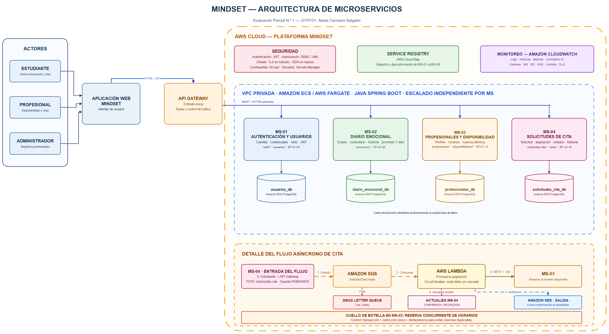

# MindSet Cloud Native

Proyecto semestral desarrollado para la asignatura **Java: Diseño y Construcción de Soluciones Nativas en Nube (JVY0101)**.

## Descripción

MindSet es una plataforma pensada para estudiantes que necesitan registrar su estado emocional y solicitar una cita con un profesional. Los profesionales pueden administrar su disponibilidad y revisar las citas que les han sido asignadas.

Esta versión corresponde a una adaptación simplificada de una idea trabajada anteriormente. El alcance se redujo para que el proyecto pueda ser desarrollado de forma individual durante el semestre.

## Funcionalidades principales

- Registro e inicio de sesión de usuarios.
- Administración de roles de estudiante, profesional y administrador.
- Registro diario de un estado emocional y un comentario opcional.
- Consulta del historial emocional y del promedio de los últimos siete días.
- Registro de profesionales por parte del administrador.
- Administración de la disponibilidad de cada profesional.
- Solicitud y asignación de citas.
- Consulta del estado y del historial de las solicitudes.
- Envío de una confirmación cuando la solicitud es procesada.

La plataforma no realiza diagnósticos médicos ni utiliza inteligencia artificial para interpretar el estado emocional del estudiante.

## Microservicios

El sistema se divide en cuatro microservicios:

1. **Autenticación y Usuarios:** administra cuentas, credenciales, roles y autenticación mediante JWT.
2. **Diario Emocional:** registra los estados emocionales, comentarios, historial y promedio semanal.
3. **Profesionales y Disponibilidad:** administra los perfiles profesionales, horarios y reserva de horas disponibles.
4. **Solicitudes de Cita:** registra las solicitudes, controla sus estados y conserva su historial.

Cada microservicio administra sus propios datos y no accede directamente a la base de datos de otro servicio.

## Arquitectura propuesta

La aplicación utiliza un API Gateway como punto de entrada. Las operaciones normales se comunican mediante REST/HTTPS y la asignación de citas se procesa de forma asíncrona mediante Amazon SQS y AWS Lambda.

La arquitectura también considera:

- Amazon ECS y AWS Fargate para ejecutar los microservicios.
- Amazon RDS PostgreSQL para la persistencia de datos.
- AWS Cloud Map para el registro y descubrimiento de servicios.
- Circuit Breaker para evitar fallos en cascada.
- Amazon SES para enviar confirmaciones.
- Amazon CloudWatch para registros, métricas y alertas.
- JWT, RBAC, IAM, TLS, BCrypt y Secrets Manager para seguridad.

El diagrama editable y su imagen exportada se encuentran en la carpeta `MindSet/anexos`.

## Estado del proyecto

La primera etapa corresponde al análisis de requerimientos y al diseño de la arquitectura de microservicios. La implementación en Java y Spring Boot se realizará durante las siguientes etapas del proyecto.

## Autor

**Alexis Carrasco Salgado**  
Usuario de GitHub: **AliceThePianist**
